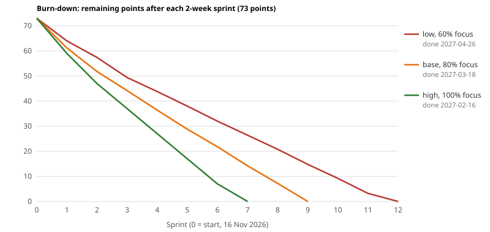

# Sprint plan, velocity and burn-rate estimate, and user story template

Written 2026-11-09 on branch `feature/project-pipeline-planning`. It turns the build plan in `docs/ME_UPCOMING_PROJECTS_AND_BUILD_PLAN.md` (functions F1 to F14, schedule in `docs/plans/me_build_plan.json`) into stories, two-week sprints, a velocity and burn-down estimate, and a template for writing the stories. Data files: [docs/plans/me_sprint_backlog.json](plans/me_sprint_backlog.json) and [docs/plans/me_burndown.svg](plans/me_burndown.svg). Nothing was built.

**The estimate rests on assumptions, not on a measured velocity.** The repository's whole history is seven days long (62 commits between 3 and 9 November 2026, every one with an AI co-author trailer), so it cannot give a team velocity and was not used as one. Points, focus factors and durations below are planning assumptions to replace with the build team's own after the first sprints.

## Units and sprint calendar
* **Point** = one ideal developer-day, taken from the activity durations in the schedule plan. Relative Fibonacci sizing can replace it once the team has calibrated.
* **Sprint** = 10 working days, Monday to Friday, no holidays entered (25 December and 1 January count as working days, which the team should correct).
* **Lanes:** a developer lane (64 points) and a domain analyst lane (9 points: spec, source reading, review). Total 73 points over 19 stories.

| Sprint | Dates |
|---|---|
| S1 | 16 to 27 Nov 2026 |
| S2 | 30 Nov to 11 Dec |
| S3 | 14 to 25 Dec |
| S4 | 28 Dec to 8 Jan 2027 |
| S5 | 11 to 22 Jan |
| S6 | 25 Jan to 5 Feb |
| S7 | 8 to 19 Feb |
| S8 | 22 Feb to 5 Mar |
| S9 | 8 to 19 Mar |
| S10 to S12 | 22 Mar to 30 Apr (only the low scenario reaches them) |

## Backlog
Stories US-01 to US-19 follow the schedule activities one for one. "Not before" stories wait for their input documents; 4 January 2027 is a placeholder gate, not a forecast. The sprint column is the base case below.

| Story | Title | Function | Lane | Points | Depends on | Sprints (base) |
|---|---|---|---|---|---|---|
| US-01 | Spec: project register and study-trigger rules | F1, F2 | analyst | 3 | none | S1 |
| US-02 | Read lifecycle rules and operator sources for triggers | F2 | analyst | 4 | US-01 | S1 |
| US-03 | Domain review of register data and rules | F1, F2 | analyst | 2 | US-06 | S2 to S3 |
| US-04 | `project_register` module and tests | F1 | dev | 4 | US-01 | S1 |
| US-05 | `study_trigger` rules and tests | F2 | dev | 4 | US-04, US-02 | S1 to S2 |
| US-06 | Study-demand roll-up and capacity link | F3 | dev | 3 | US-05 | S2 |
| US-07 | Tool wiring, examples, scenarios | F1 to F3 | dev | 3 | US-06 | S2 to S3 |
| US-08 | Docs, changelog, gates | F1 to F3 | dev | 2 | US-07 | S3 |
| US-09 | Gulf bid mechanics: fields and checks | F4 | dev | 3 | US-08, US-03 | S3 |
| US-10 | Eligibility checker | F5 | dev | 4 | US-09 | S3 to S4 |
| US-11 | Bid compliance matrix | F6 | dev | 3 | US-10 | S4 |
| US-12 | Wiring, scenarios, docs for the bid tools | F4 to F6 | dev | 3 | US-11 | S4 to S5 |
| US-13 | WBS templates by study type | F7 | dev | 3 | US-12 | S5 |
| US-14 | P&ID register to HAZOP nodes to WBS | F8 | dev | 5 | US-13 | S5 to S6 |
| US-15 | Gates, changelog, release | F1 to F8 | dev | 2 | US-14 | S6 |
| US-16 | Gulf QRA criteria set and contour-confinement check | F9 | dev | 6 | US-15; not before 4 Jan 2027 | S6 to S7 |
| US-17 | PSV staggered set-point review | F10 | dev | 5 | US-16 | S7 to S8 |
| US-18 | Risk-based inspection screening | F11 | dev | 6 | US-17 | S8 |
| US-19 | Pipeline QRA screening for long gas lines | F12 | dev | 8 | US-18 | S8 to S9 |

F13 (LNG consequences) and F14 (hydrogen and ammonia) have no stories: they wait on method sources that have not been found. F15 stays out of the repository.

## Velocity and burn-rate estimate
**Planning velocity** per lane = 10 ideal days × focus factor. The focus factor is the share of a sprint that goes to these stories after meetings, reviews, interruptions and rework. I assumed three values, not measured ones.

| Scenario | Focus | Velocity per sprint, per lane | Burn rate per lane | Build-now scope done (US-15) | Everything done | Sprints |
|---|---|---|---|---|---|---|
| Low | 60% | 6 points | 0.6 points a day | 24 Feb 2027 | 26 Apr 2027 | 12 |
| Base | 80% | 8 points | 0.8 points a day | 1 Feb 2027 | 18 Mar 2027 | 9 |
| High | 100% | 10 points | 1.0 points a day | 12 Jan 2027 | 16 Feb 2027 | 7 |

The high case reproduces the toolkit's own `schedule` result (build-now scope on 12 January, everything on 16 February 2027), which cross-checks the simulation. The scenarios were produced by a day-by-day simulation: each lane works the first ready story each day at its burn rate; a story is ready when its dependencies finished the day before; gated stories wait for 4 January 2027.

**Combined points burned per sprint** (both lanes; the first sprints burn more because the analyst lane is active):

| Scenario | S1 | S2 | S3 | S4 | S5 | S6 | S7 | S8 | S9 | S10 | S11 | S12 |
|---|---|---|---|---|---|---|---|---|---|---|---|---|
| Low | 9.0 | 6.6 | 8.0 | 5.6 | 5.8 | 6.0 | 5.6 | 5.6 | 6.0 | 5.6 | 6.0 | 3.2 |
| Base | 11.8 | 9.4 | 7.6 | 7.8 | 7.6 | 7.0 | 7.6 | 7.0 | 7.2 | | | |
| High | 14.0 | 12.0 | 10.0 | 10.0 | 10.0 | 10.0 | 7.0 | | | | | |

**Calibration rule.** After Sprint 1 and Sprint 2, replace the assumed velocity with the mean points accepted as done under the Definition of Done, then re-forecast: sprints left = remaining points ÷ observed velocity, rounded up, with a band of 75% and 125% of that velocity. Accepted means finished against the Definition of Done below, not merely coded.

## Burn-down
Remaining points after each sprint, out of 73:

| After sprint | 0 | 1 | 2 | 3 | 4 | 5 | 6 | 7 | 8 | 9 | 10 | 11 | 12 |
|---|---|---|---|---|---|---|---|---|---|---|---|---|---|
| Low | 73 | 64.0 | 57.4 | 49.4 | 43.8 | 38.0 | 32.0 | 26.4 | 20.8 | 14.8 | 9.2 | 3.2 | 0 |
| Base | 73 | 61.2 | 51.8 | 44.2 | 36.4 | 28.8 | 21.8 | 14.2 | 7.2 | 0 | | | |
| High | 73 | 59.0 | 47.0 | 37.0 | 27.0 | 17.0 | 7.0 | 0 | | | | | |



## Sprint plan, base case
| Sprint | Goal | Stories finishing | Burned |
|---|---|---|---|
| S1 | Spec agreed; register built | US-01, US-02, US-04 | 11.8 |
| S2 | Trigger rules and demand roll-up | US-05, US-06 | 9.4 |
| S3 | Block A complete; bid mechanics | US-03, US-07, US-08, US-09 | 7.6 |
| S4 | Eligibility and compliance matrix | US-10, US-11 | 7.8 |
| S5 | Bid tools shipped; study templates | US-12, US-13 | 7.6 |
| S6 | Build-now scope complete | US-14, US-15 (1 Feb) | 7.0 |
| S7 | Gulf QRA criteria set, if inputs are in hand | US-16 | 7.6 |
| S8 | PSV review and RBI screening | US-17, US-18 | 7.0 |
| S9 | Pipeline QRA screening | US-19 | 7.2 |

Each sprint ends with a review against the Definition of Done and a velocity update. A story that stops on missing input moves to the next sprint with its blocker named; it is not counted as burned.

## User story template
Copy this block for each story. Fill every field; a story without a refusal and an identity criterion is not ready.

```
### US-NN <short title>
**As a** <role>, **I want** <function, in the toolkit's terms>, **so that** <outcome that matters to a bid or a study>.

- Function: Fn      Lane: dev | analyst      Points: n (ideal developer-days)
- Depends on: US-..      Not before: <date, or the input document it waits for>
- Inputs needed: <data or documents, and who supplies them>
- Acceptance criteria
  1. Given <valid input>, when <action>, then <result>.
  2. Refusal: given <bad input>, when <action>, then it refuses with <message> and writes nothing.
  3. Identity: <conservation, monotonic or limit relation the test checks; no remembered numbers>.
  4. Not computed: given <a missing input>, when <action>, then the output says "not computed" and why.
- Out of scope: <what it will not do>
- Sources: <title, edition, clause or URL that was read; or "inputs only: no constant coded">
- Notes and decisions: <alternatives rejected, to be copied to CHANGELOG.md>
```

**Roles:** bid manager, process safety lead, project planner, study engineer, toolkit maintainer.

**Definition of Ready:** inputs are in hand or the story is marked not-before; any source it needs has been read, not searched; points are estimated; dependencies are named; the acceptance criteria include a refusal and an identity.

**Definition of Done** (from `CLAUDE.md` and `CONTRIBUTING.md`):
* Standard library only; every number has a source or is an input; paywalled values stay inputs.
* Identity tests written first and seen failing, then passing; refusals tested.
* New numeric CLI arguments have a `ranges` entry or units; the limits statement appears in new CLI output.
* A scenario in `tests/scenarios/scenarios.json` with an oracle or a metamorphic relation.
* `python -m unittest discover tests` and the `ruff` command from `CLAUDE.md` run, with the results stated; skipped checks named.
* Generated docs regenerated (`INPUT_TEMPLATES`, `SCENARIO_REPORT`, and `RANGES` or `GLOSSARY` when touched); `tests/golden/cli_golden.json` updated, with the reason, if CLI output changed on purpose.
* `CHANGELOG.md` entry with decisions and rejected alternatives.
* Recommended, not a repository rule: mutate each new constant or exponent once and confirm a test fails.

### Example 1: US-04
**As a** bid manager, **I want** a register of upcoming projects with stage, key dates, source and grade, **so that** I can see which studies fall due and where my information is weakest.
* Function: F1. Lane: dev. Points: 4. Depends on: US-01. Not before: none.
* Inputs needed: project facts with source links; P1 to P13 in `docs/ME_UPCOMING_PROJECTS_AND_BUILD_PLAN.md` are the first entries.
* Acceptance criteria:
  1. Given entries with a stage from the allowed list and ISO dates in order (FID, EPC award, mechanical completion, first production, where present), when `check` runs, then it returns no errors.
  2. Refusal: given an unknown stage, dates out of order, a missing source or a grade other than A, B or C, then it refuses and names the entry.
  3. Identity: the count by stage sums to the number of projects, and filtering by country then by stage gives the same set as the reverse order.
  4. Not computed: given an entry with no last-checked date, the report lists it as "not checked" instead of treating it as current.
* Out of scope: fetching anything from the web.
* Sources: inputs only. The stage list (concept, FEED, tender, EPC, construction, commissioning, operating) is a planning vocabulary, not a standard.

### Example 2: US-09
**As a** bid manager, **I want** each tender to carry its document-purchase window, registration status, bond amount and validity, offer validity and local-content status, **so that** a missed pre-bid step is flagged before the deadline.
* Function: F4. Lane: dev. Points: 3. Depends on: US-08, US-03. Not before: none.
* Inputs needed: per-tender dates and amounts from the tender package. No validity period or bond amount is coded.
* Acceptance criteria:
  1. Given a bid-close date and validity periods in days, when the check runs, then the offer-validity and bond-validity end dates are close date plus the given days.
  2. Refusal: given a negative amount or validity, or a date that is not ISO, then it refuses.
  3. Identity: shifting the bid-close date by n days shifts both end dates by n days.
  4. Not computed: given a missing registration status, the tender appears under "action needed" and is never treated as registered.
  5. Warning: given a bond that expires before the offer validity ends, the tender is flagged.
* Out of scope: bond pricing and currency conversion.
* Sources: inputs only. The QatarEnergy tender listing (120-day offer, 150-day bond) is an example of the fields, not a default.

## Risks and what was not checked
* **Single developer:** one absence stops the critical path; there is no float on the developer chain.
* **Gated stories:** US-16 to US-19 depend on documents that may not arrive; their dates are placeholders.
* **Estimates:** every point value is a duration estimate by the author of the plan; the first sprint will show how far off they are.
* **Not checked:** the build team's real capacity, holidays, and the focus factor; how long domain reviews take in practice; whether the analyst lane is available full-time.
